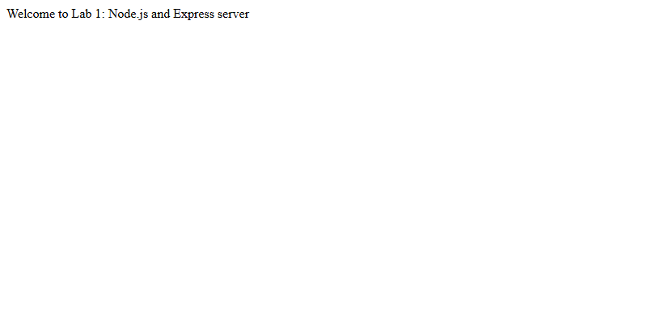
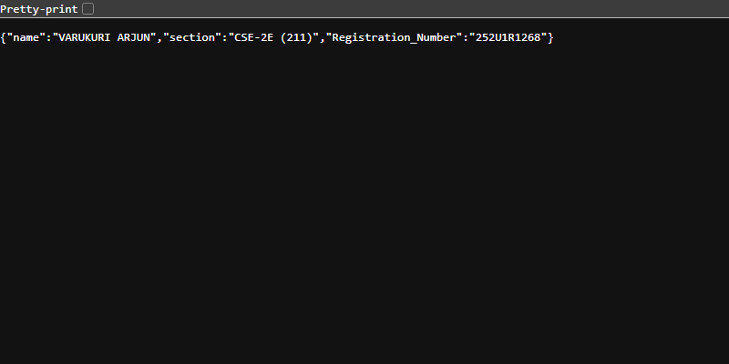

# Lab 1: Node.js and Express Server

> **🔗 GitHub Repository:** [https://github.com/Arjun9311/backend-labs](https://github.com/Arjun9311/backend-labs)  
> **🌐 Local Base URL:** [http://localhost:3000](http://localhost:3000)

---

## 📋 Student Information

| Field | Details |
|:---|:---|
| **Name** | VARUKURI ARJUN |
| **Registration Number** | 252U1R1268 |
| **Section** | CSE-2E (211) |
| **Course** | Backend Development Fundamentals · Year II Term II |
| **Faculty** | Mr Yugandhar Gurjalwar |
| **College** | Aurora Deemed-to-be-University |
| **Repository** | [https://github.com/Arjun9311/backend-labs](https://github.com/Arjun9311/backend-labs) |

---

## 🎯 Objective

Initialize and structure a foundational Node.js and Express.js backend application. Understand HTTP server mechanics by constructing both a core Node.js `http` module server and an Express web framework server. Implement basic routing, handle JSON payloads, format dynamic responses, configure environment variables, understand `package.json` manifest structure, and handle 404 unhandled paths.

---

## 🛠️ Technologies Used

| Technology | Purpose |
|:---|:---|
| **Node.js** | JavaScript runtime environment for backend development |
| **Express.js** | Minimal and flexible Node.js web application framework |
| **HTTP Module** | Built-in Node.js module used to illustrate foundational HTTP request/response lifecycles |
| **Postman & curl** | Tooling used to send HTTP requests and verify responses |
| **Git & GitHub** | Distributed version control and source code repository |

---

## ⚙️ Installation & Setup

1. **Navigate to the Lab 1 directory:**
   ```bash
   cd lab-01
   ```

2. **Install project dependencies:**
   ```bash
   npm install
   ```

3. **Configure Environment:**
   Create `.env` from `.env.example`:
   ```bash
   cp .env.example .env
   ```
   *Environment variables:*
   - `PORT=3000`

4. **Start the Express Server:**
   ```bash
   npm start
   ```
   The Express server listens at `http://localhost:3000`.

5. **Start the Plain HTTP Server (Alternative):**
   ```bash
   npm run plain
   ```
   The core HTTP server listens at `http://localhost:3000`.

---

## 📡 API Endpoints

| Method | Path | Example URL | Description | Status Code |
|:---:|:---|:---|:---|:---:|
| `GET` | `/` | `http://localhost:3000/` | Root welcome message | `200 OK` |
| `GET` | `/about` | `http://localhost:3000/about` | Student information JSON object | `200 OK` |
| `GET` | `/time` | `http://localhost:3000/time` | Current server timestamp in plain text | `200 OK` |
| `ALL` | `/*` | `http://localhost:3000/undefined-route` | Catch-all handler for undefined routes | `404 Not Found` |

---

## 📤 Sample Responses

### GET /
```text
Hello, World! Welcome to Lab 1 Express Server.
```

### GET /about
```json
{
  "name": "VARUKURI ARJUN",
  "registrationNumber": "252U1R1268",
  "section": "CSE-2E (211)",
  "course": "Backend Development Fundamentals"
}
```

### GET /time
```text
Sat Nov 07 2026 09:00:00 GMT+0530 (India Standard Time)
```

### GET /unknown
```text
404 - Page not found
```

---

## 📸 Verification & Screenshots

### 1. Root Route (`GET /`)


### 2. About Route (`GET /about`)


### 3. Server Time Route (`GET /time`)


### 4. Catch-All Route (`404 Not Found`)


---

## 📦 `package.json` Fields Explained

- **`name`**: The unique identifier of the package/project (`lab-01`).
- **`version`**: The current semantic version of the application (`1.0.0`).
- **`description`**: A concise explanation of the repository or subproject purpose.
- **`main`**: The primary entry point file of the application executed on start (`server.js`).
- **`scripts`**: Executable CLI shortcut commands (e.g. `npm start` runs `node server.js`).
- **`dependencies`**: Production dependencies required for application execution (e.g. `express`).
- **`author`**: The creator or maintainer of the project (`VARUKURI ARJUN`).
- **`license`**: The software distribution license governing usage (`ISC`).

---

## 🎓 Viva Questions & Answers

| Question | Answer |
|:---|:---|
| **What is the difference between `package.json` and `node_modules`?** | `package.json` is a lightweight manifest file committed to version control that records project metadata, script commands, and direct dependencies with semantic version rules. `node_modules` is an uncommitted local directory generated by `npm install` containing the downloaded source code of all direct and transitive dependencies. |
| **What does `app.listen()` do under the hood?** | `app.listen(PORT, callback)` binds the Express application to a specific TCP port and network interface on the host machine. It initializes an HTTP server instance (wrapping Node's native `http.createServer`) and continuously listens for incoming client TCP socket connections, invoking the callback once listening. |
| **What do `req` (Request) and `res` (Response) represent?** | **`req`** encapsulates the incoming HTTP request from the client, including headers, query parameters, URL path, route params, and body data. **`res`** represents the outgoing HTTP response, exposing methods to set HTTP status codes (`res.status()`), configure headers (`res.set()`), and send back content (`res.send()`, `res.json()`). |

---

## 👤 Author

**VARUKURI ARJUN**  
Registration Number: **252U1R1268**  
Section: **CSE-2E (211)**  
Aurora Deemed-to-be-University  
Faculty: **Mr Yugandhar Gurjalwar**
