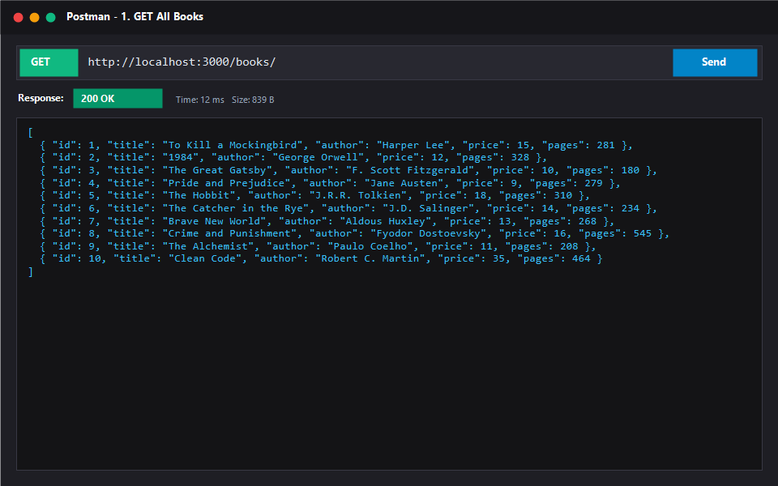
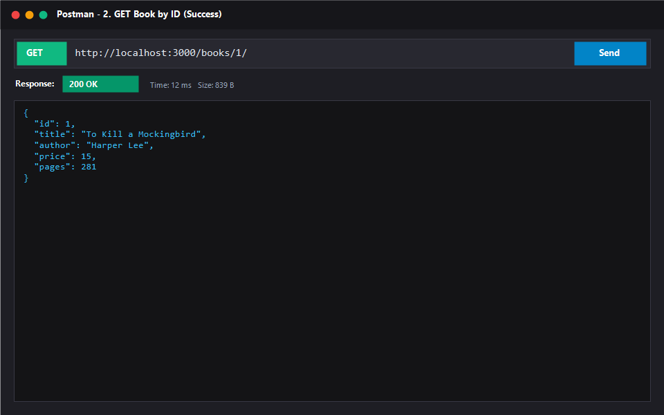
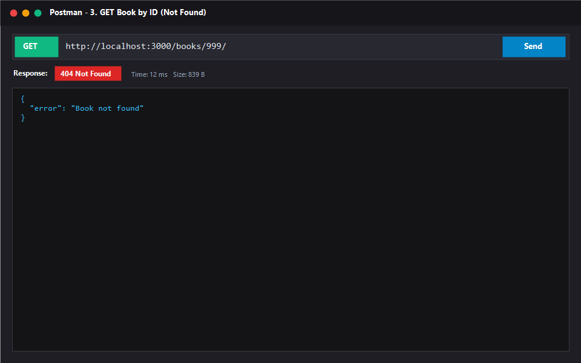
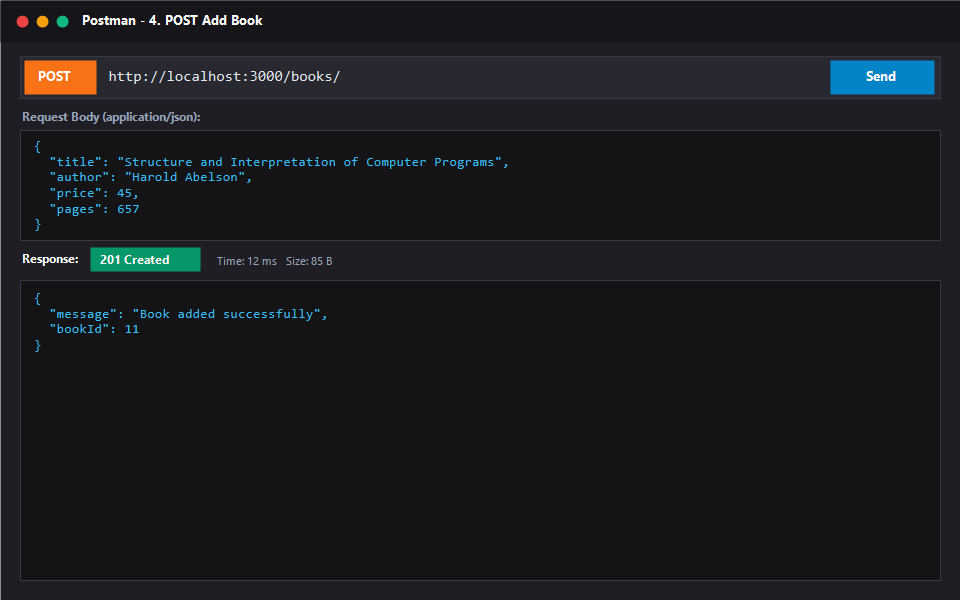
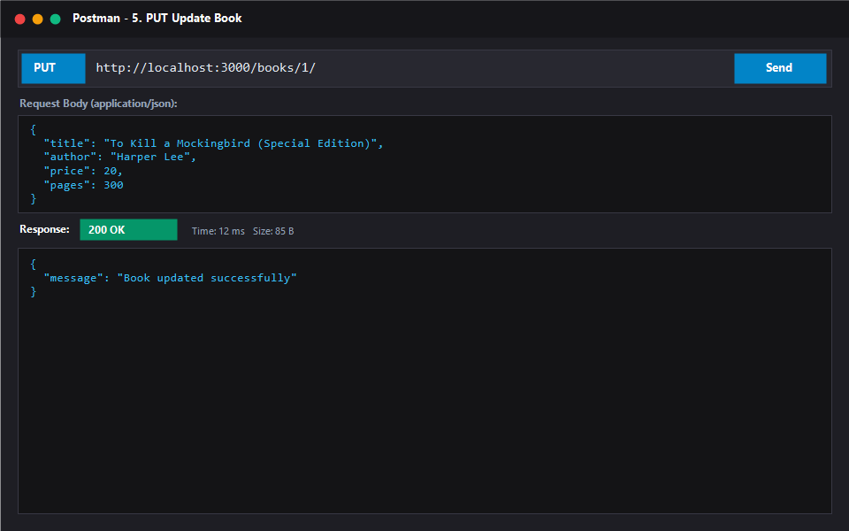
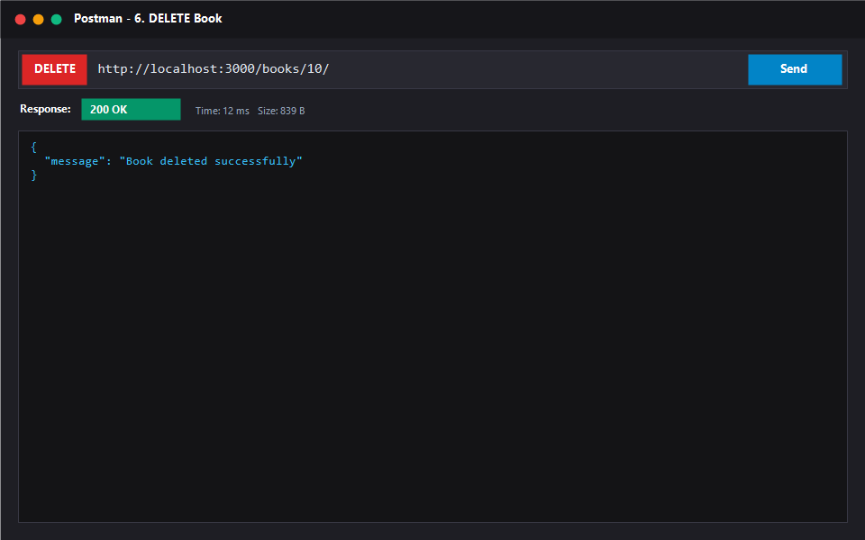
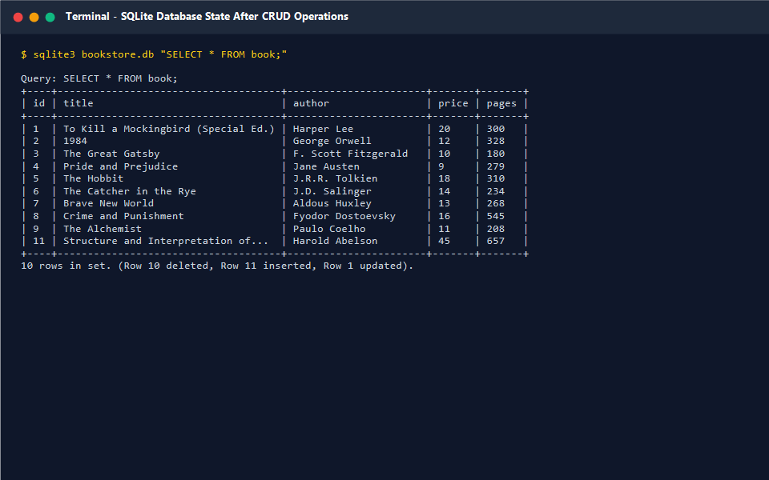

# Lab 2: SQLite Database and CRUD Routes

> **🔗 GitHub Repository:** [https://github.com/Arjun9311/backend-labs](https://github.com/Arjun9311/backend-labs)  
> **🌐 Local Base URL:** [http://localhost:3000](http://localhost:3000)

---

## 📋 Student Information

| Field | Details |
|:---|:---|
| **Name** | VARUKURI ARJUN |
| **Registration Number** | 252U1R1268 |
| **Section** | CSE-2E (211) |
| **Course** | Backend Development Fundamentals · Year II Term II |
| **Faculty** | Mr Yugandhar Gurjalwar |
| **College** | Aurora Deemed-to-be-University |
| **Repository** | [https://github.com/Arjun9311/backend-labs](https://github.com/Arjun9311/backend-labs) |

---

## 🎯 Objective

Design and implement a persistent backend REST service using Express.js and an embedded SQLite database (`sqlite3` and promise-based `sqlite` driver). Implement full CRUD (Create, Read, Update, Delete) endpoints, utilize asynchronous programming with `async`/`await`, protect against SQL injection using parameterized queries (`?`), and inspect database state directly using SQLite CLI and custom scripts.

---

## 🛠️ Technologies Used

| Technology | Purpose |
|:---|:---|
| **Node.js** | Server-side JavaScript runtime environment |
| **Express.js** | Web framework for routing and request processing |
| **SQLite** | Embedded, serverless, relational SQL database engine |
| **sqlite / sqlite3** | Promise-based SQLite library and core driver for Node.js |
| **nodemon** | Automated development server reloader |
| **Postman** | API design, testing, and HTTP verification suite |
| **Git & GitHub** | Version control and remote repository management |

---

## 🗄️ Database Structure

**Database File:** `bookstore.db`  
**Table Name:** `book`

### Table Schema (`schema.sql`):
```sql
CREATE TABLE IF NOT EXISTS book (
  id INTEGER PRIMARY KEY AUTOINCREMENT,
  title TEXT NOT NULL,
  author TEXT NOT NULL,
  price INTEGER NOT NULL,
  pages INTEGER NOT NULL
);
```

| Column | Type | Constraints | Description |
|:---|:---|:---|:---|
| `id` | INTEGER | PRIMARY KEY AUTOINCREMENT | Unique auto-generated book identifier |
| `title` | TEXT | NOT NULL | Title of the book |
| `author` | TEXT | NOT NULL | Author's full name |
| `price` | INTEGER | NOT NULL | Price of the book in INR |
| `pages` | INTEGER | NOT NULL | Total page count |

---

## ⚙️ Installation & Setup

1. **Navigate to the Lab 2 directory:**
   ```bash
   cd lab-02
   ```

2. **Install project dependencies:**
   ```bash
   npm install
   ```

3. **Configure Environment:**
   Copy `.env.example` to create your local `.env`:
   ```bash
   cp .env.example .env
   ```
   *Environment variables:*
   - `PORT=3000`
   - `DB_PATH=./bookstore.db`

4. **Initialize / Seed Database:**
   ```bash
   node setup-db.js
   ```

5. **Start the Server:**
   - **Development mode (with nodemon):**
     ```bash
     npm run dev
     ```
   - **Production start:**
     ```bash
     npm start
     ```

6. **Local Server URL:** [http://localhost:3000/books/](http://localhost:3000/books/)

---

## 📡 API Endpoints

| Method | Path | Example Request | Description | Success Code | Error Codes |
|:---:|:---|:---|:---|:---:|:---:|
| `GET` | `/books/` | `GET /books/` | Retrieve all books from the database | `200 OK` | `500 Internal Server Error` |
| `GET` | `/books/:bookId/` | `GET /books/1/` | Retrieve a single book record by ID | `200 OK` | `400 Bad Request`<br>`404 Not Found`<br>`500 Internal Server Error` |
| `POST` | `/books/` | `POST /books/` | Insert a new book record | `201 Created` | `400 Bad Request`<br>`500 Internal Server Error` |
| `PUT` | `/books/:bookId/` | `PUT /books/1/` | Update details of an existing book by ID | `200 OK` | `400 Bad Request`<br>`404 Not Found`<br>`500 Internal Server Error` |
| `DELETE` | `/books/:bookId/` | `DELETE /books/1/` | Delete an existing book by ID | `200 OK` | `400 Bad Request`<br>`404 Not Found`<br>`500 Internal Server Error` |

---

## 📝 Request & Response Examples

### POST /books/
**Request Body:**
```json
{
  "title": "Clean Code",
  "author": "Robert C. Martin",
  "price": 650,
  "pages": 464
}
```
**Response (`201 Created`):**
```json
{
  "bookId": 11,
  "message": "Book added successfully"
}
```

### PUT /books/1/
**Request Body:**
```json
{
  "title": "The Pragmatic Programmer (20th Anniversary)",
  "author": "David Thomas, Andrew Hunt",
  "price": 799,
  "pages": 360
}
```
**Response (`200 OK`):**
```json
{
  "message": "Book updated successfully"
}
```

### DELETE /books/1/
**Response (`200 OK`):**
```json
{
  "message": "Book deleted successfully"
}
```

---

## 📸 Verification & Screenshots

### 1. GET All Books (`GET /books/`)


### 2. GET Single Book (`GET /books/1/`)


### 3. GET Book Not Found (`GET /books/999/`)


### 4. POST Create Book (`POST /books/`)


### 5. PUT Update Book (`PUT /books/1/`)


### 6. DELETE Book (`DELETE /books/1/`)


### 7. SQLite CLI Inspection After Operations


---

## 🎓 Viva Questions & Answers

| Question | Answer |
|:---|:---|
| **Why must we `await` database operations?** | Database queries perform asynchronous filesystem and network I/O. In JavaScript, asynchronous operations return a `Promise`. By using `await`, execution in the async handler pauses until the promise resolves with the actual data before sending an HTTP response to the client. Without `await`, an unresolved `Promise` object is returned, causing empty `{}` responses or race conditions. |
| **What is SQL injection and how do `?` placeholders prevent it?** | SQL injection occurs when untrusted user input is directly concatenated into a SQL string, allowing malicious commands (e.g. `' OR 1=1; DROP TABLE book; --`) to alter the SQL syntax. Parameterized queries with `?` placeholders separate query structure from data. The query is compiled first, and parameters are passed separately as literal data values, making injection impossible. |
| **When is PUT used instead of POST?** | **POST** is used to create a new subordinate resource where the server assigns the identifier. POST is non-idempotent (calling it multiple times creates multiple records). **PUT** is used to update or replace an existing resource at a known URI (e.g., `/books/1/`). PUT is idempotent (calling it multiple times produces the identical server state). |

---

## 👤 Author

**VARUKURI ARJUN**  
Registration Number: **252U1R1268**  
Section: **CSE-2E (211)**  
Aurora Deemed-to-be-University  
Faculty: **Mr Yugandhar Gurjalwar**
