# Lab 3: REST API, Query Parameters, Validation, and Debugging

> **🔗 GitHub Repository:** [https://github.com/Arjun9311/backend-labs](https://github.com/Arjun9311/backend-labs)  
> **🌐 Local Base URL:** [http://localhost:3000](http://localhost:3000)

---

## 📋 Student Information

| Field | Details |
|:---|:---|
| **Name** | VARUKURI ARJUN |
| **Registration Number** | 252U1R1268 |
| **Section** | CSE-2E (211) |
| **Course** | Backend Development Fundamentals · Year II Term II |
| **Faculty** | Mr Yugandhar Gurjalwar |
| **College** | Aurora Deemed-to-be-University |
| **Repository** | [https://github.com/Arjun9311/backend-labs](https://github.com/Arjun9311/backend-labs) |

---

## 🎯 Objective

Build a production-ready Node.js and Express RESTful API with SQLite database integration. Implement advanced query parameter capabilities on `GET /books` (case-insensitive search, dynamic column sorting, sort direction, pagination via limit and offset, and numeric price range filtering), enforce strict request payload validation with consistent JSON error responses, apply JavaScript column whitelisting and parameterized queries (`?`) to prevent SQL injection, and systematically diagnose deliberate server bugs in a dedicated debugging exercise.

---

## 🛠️ Technologies Used

| Technology | Purpose |
|:---|:---|
| **Node.js** | Server-side JavaScript runtime environment for backend execution |
| **Express.js** | Fast, unopinionated web framework for routing and RESTful APIs |
| **SQLite** | Self-contained, serverless, zero-configuration relational database engine |
| **sqlite / sqlite3** | Asynchronous promise-based SQLite client and driver for Node.js |
| **nodemon** | Utility that monitors files and automatically restarts the server on change |
| **Postman** | API development, manual endpoint testing, and request verification |
| **Git & GitHub** | Distributed version control and remote code repository |
| **Render** | Cloud hosting platform for live application deployment |

---

## 🗄️ Database Structure

**Database File:** `bookstore.db`  
**Table Name:** `book`

| Column | Type | Description |
|:---|:---|:---|
| `id` | INTEGER PRIMARY KEY AUTOINCREMENT | Unique identifier for each book record |
| `title` | TEXT NOT NULL | Title of the book |
| `author` | TEXT NOT NULL | Full name of the author |
| `price` | INTEGER NOT NULL | Price in currency units / INR |
| `pages` | INTEGER NOT NULL | Total page count |

### Sample Data (15 Books from `seed.sql`)

| ID | Title | Author | Price (₹) | Pages |
|:---:|:---|:---|:---:|:---:|
| 1 | Pride and Prejudice | Jane Austen | 8 | 279 |
| 2 | The Great Gatsby | F. Scott Fitzgerald | 10 | 180 |
| 3 | The Alchemist | Paulo Coelho | 11 | 208 |
| 4 | 1984 | George Orwell | 12 | 328 |
| 5 | Brave New World | Aldous Huxley | 13 | 268 |
| 6 | The Catcher in the Rye | J.D. Salinger | 14 | 234 |
| 7 | To Kill a Mockingbird | Harper Lee | 15 | 281 |
| 8 | Crime and Punishment | Fyodor Dostoevsky | 16 | 545 |
| 9 | Frankenstein | Mary Shelley | 17 | 224 |
| 10 | The Hobbit | J.R.R. Tolkien | 18 | 310 |
| 11 | The Hitchhiker's Guide to the Galaxy | Douglas Adams | 20 | 218 |
| 12 | Dune | Frank Herbert | 24 | 680 |
| 13 | One Hundred Years of Solitude | Gabriel García Márquez | 28 | 417 |
| 14 | The Pragmatic Programmer | Andy Hunt | 32 | 352 |
| 15 | Clean Code | Robert C. Martin | 40 | 464 |

---

## 🔌 Database Initialization

The asynchronous initialization function `initializeDBAndServer()` executes at startup:

1. **Connects to SQLite:** Opens `bookstore.db` using `open()` from `sqlite` with the `sqlite3.Database` driver.
2. **Creates Table:** Executes `CREATE TABLE IF NOT EXISTS book` to initialize schema structure.
3. **Automated Seeding:** Checks the current row count in `book`; if fewer than 15 rows exist, runs `seed.sql` to populate initial test data.
4. **Server Binding:** Binds Express to `process.env.PORT || 3000` and starts listening for incoming requests.
5. **Port Conflict Safeguard:** Attaches an `error` event listener to catch `EADDRINUSE` errors gracefully.

---

## ⚙️ Installation & Setup

### Prerequisites
- **Node.js** (v18.x or v20.x LTS recommended)
- **npm** (bundled with Node.js)

### Step-by-Step Instructions

1. **Navigate to the Lab 3 directory:**
   ```bash
   cd lab-03
   ```

2. **Install project dependencies:**
   ```bash
   npm install
   ```

3. **Configure Environment Variables:**
   Copy `.env.example` to create your local `.env`:
   ```bash
   cp .env.example .env
   ```
   *Default configuration:*
   ```env
   PORT=3000
   DB_PATH=./bookstore.db
   ```

4. **Initialize / Seed Database:**
   ```bash
   node setup-db.js
   ```

5. **Start the Development Server (with auto-reload):**
   ```bash
   npm run dev
   ```

6. **Start the Production Server:**
   ```bash
   npm start
   ```

7. **Run Automated Test Suite (29 Tests):**
   ```bash
   npm test
   ```

8. **Local Base URL:** [http://localhost:3000](http://localhost:3000)

---

## 📡 API Endpoints

| Method | Path | Example URL | Description | Status Code |
|:---:|:---|:---|:---|:---:|
| `GET` | `/` | `http://localhost:3000/` | API directory, student information & health check | `200 OK` |
| `GET` | `/books` | `http://localhost:3000/books` | Retrieve books with default pagination (`limit=10`) | `200 OK` / `400 Bad Request` |
| `GET` | `/books/:bookId` | `http://localhost:3000/books/1` | Retrieve a single book by ID | `200 OK` / `400 Bad Request` / `404 Not Found` |
| `POST` | `/books` | `http://localhost:3000/books` | Create and insert a new book record | `201 Created` / `400 Bad Request` |
| `PUT` | `/books/:bookId` | `http://localhost:3000/books/15` | Update details of an existing book by ID | `200 OK` / `400 Bad Request` / `404 Not Found` |
| `DELETE` | `/books/:bookId` | `http://localhost:3000/books/15` | Delete a book record by ID | `200 OK` / `400 Bad Request` / `404 Not Found` |
| `GET` | `/books/999` | `http://localhost:3000/books/999` | Verify 404 response for non-existent record | `404 Not Found` |
| `GET` | `/*` | `http://localhost:3000/unknown-route` | Catch-all handler for undefined routes | `404 Not Found` |

---

## 🔍 Query Parameters on GET /books

All query parameters are optional and have built-in default values. They can be used individually or combined:

| Parameter | Type | Default | Allowed Values / Constraints | Example URL | Description |
|:---|:---:|:---:|:---|:---|:---|
| `search_q` | String | `""` | Any text string | `?search_q=Clean` | Case-insensitive title search via `LIKE ?` |
| `order_by` | String | `"id"` | `id`, `title`, `author`, `price`, `pages` | `?order_by=price` | Whitelisted column name to order results by |
| `order` | String | `"ASC"` | `ASC`, `DESC` (case-insensitive) | `?order=DESC` | Sort direction (ascending or descending) |
| `limit` | Integer | `10` | Integer between `1` and `100` | `?limit=5` | Maximum number of book records to return |
| `offset` | Integer | `0` | Non-negative integer (`>= 0`) | `?offset=5` | Number of records to skip (for pagination) |
| `min_price` | Integer | None | Non-negative integer (`>= 0`) | `?min_price=12` | Lower bound price filter (`price >= ?`) |
| `max_price` | Integer | None | Non-negative integer (`>= 0`) | `?max_price=20` | Upper bound price filter (`price <= ?`) |

### Combined Filter Example
- **URL:** `http://localhost:3000/books?search_q=The&min_price=10&max_price=25&order_by=price&order=DESC&limit=5&offset=0`
- **Filters Applied:** Searches for `"The"` in title, filters price between `10` and `25`, sorts by `price DESC`, limits result set to `5` records with `offset=0`.

---

## 📝 Sample Request Bodies

### POST /books (Add a new book)
```json
{
  "title": "Introduction to Algorithms",
  "author": "Thomas H. Cormen",
  "price": 38,
  "pages": 1312
}
```

### PUT /books/15 (Update a book)
```json
{
  "title": "Clean Code: A Handbook of Agile Software Craftsmanship",
  "author": "Robert C. Martin",
  "price": 42,
  "pages": 464
}
```

---

## 📤 Expected Responses

### GET /books (Default List: First 10 Books)
```json
[
  { "id": 1, "title": "Pride and Prejudice", "author": "Jane Austen", "price": 8, "pages": 279 },
  { "id": 2, "title": "The Great Gatsby", "author": "F. Scott Fitzgerald", "price": 10, "pages": 180 },
  { "id": 3, "title": "The Alchemist", "author": "Paulo Coelho", "price": 11, "pages": 208 },
  { "id": 4, "title": "1984", "author": "George Orwell", "price": 12, "pages": 328 },
  { "id": 5, "title": "Brave New World", "author": "Aldous Huxley", "price": 13, "pages": 268 },
  { "id": 6, "title": "The Catcher in the Rye", "author": "J.D. Salinger", "price": 14, "pages": 234 },
  { "id": 7, "title": "To Kill a Mockingbird", "author": "Harper Lee", "price": 15, "pages": 281 },
  { "id": 8, "title": "Crime and Punishment", "author": "Fyodor Dostoevsky", "price": 16, "pages": 545 },
  { "id": 9, "title": "Frankenstein", "author": "Mary Shelley", "price": 17, "pages": 224 },
  { "id": 10, "title": "The Hobbit", "author": "J.R.R. Tolkien", "price": 18, "pages": 310 }
]
```

### GET /books?search_q=Clean (Search by Title)
```json
[
  {
    "id": 15,
    "title": "Clean Code",
    "author": "Robert C. Martin",
    "price": 40,
    "pages": 464
  }
]
```

### GET /books?order_by=price&order=ASC&limit=5 (Sorted by Price ASC)
```json
[
  { "id": 1, "title": "Pride and Prejudice", "author": "Jane Austen", "price": 8, "pages": 279 },
  { "id": 2, "title": "The Great Gatsby", "author": "F. Scott Fitzgerald", "price": 10, "pages": 180 },
  { "id": 3, "title": "The Alchemist", "author": "Paulo Coelho", "price": 11, "pages": 208 },
  { "id": 4, "title": "1984", "author": "George Orwell", "price": 12, "pages": 328 },
  { "id": 5, "title": "Brave New World", "author": "Aldous Huxley", "price": 13, "pages": 268 }
]
```

### GET /books?limit=5&offset=5 (Pagination: Page 2 of 5 Books)
```json
[
  { "id": 6, "title": "The Catcher in the Rye", "author": "J.D. Salinger", "price": 14, "pages": 234 },
  { "id": 7, "title": "To Kill a Mockingbird", "author": "Harper Lee", "price": 15, "pages": 281 },
  { "id": 8, "title": "Crime and Punishment", "author": "Fyodor Dostoevsky", "price": 16, "pages": 545 },
  { "id": 9, "title": "Frankenstein", "author": "Mary Shelley", "price": 17, "pages": 224 },
  { "id": 10, "title": "The Hobbit", "author": "J.R.R. Tolkien", "price": 18, "pages": 310 }
]
```

### GET /books/1 (Single Book by ID)
```json
{
  "id": 1,
  "title": "Pride and Prejudice",
  "author": "Jane Austen",
  "price": 8,
  "pages": 279
}
```

### POST /books (201 Created)
```json
{
  "message": "Book added successfully",
  "bookId": 16
}
```

### PUT /books/15 (200 OK)
```json
{
  "message": "Book updated successfully"
}
```

### DELETE /books/15 (200 OK)
```json
{
  "message": "Book deleted successfully"
}
```

### Validation Error (400 Bad Request)
```json
{
  "message": "title is required and must be a non-empty string"
}
```

### Resource Not Found (404 Not Found)
```json
{
  "message": "Book not found"
}
```

### Catch-All Route Not Found (404 Not Found)
```json
{
  "message": "Route not found"
}
```

---

## 🛡️ SQL Injection Prevention & Whitelisting

Security is maintained through two strict mechanisms:

### 1. Parameterized Queries (`?` Placeholders)
User-supplied values (search keywords, price bounds, pagination numbers, record IDs) are never concatenated directly into SQL strings. Instead, they are passed as bind parameters through the database driver:
```sql
SELECT * FROM book WHERE title LIKE ? AND price >= ? AND price <= ? ORDER BY price ASC LIMIT ? OFFSET ?
```
The database engine compiles and parses the query template before values are supplied, guaranteeing user input is treated strictly as literal data rather than executable SQL code.

### 2. JavaScript Whitelisting for `ORDER BY`
SQL parameter placeholders cannot bind column names or sort order keywords (`ASC`/`DESC`). To allow safe dynamic sorting without introducing SQL injection vulnerabilities, query values are strictly validated against an in-memory whitelist array:
```javascript
const ALLOWED_ORDER_BY = ['id', 'title', 'author', 'price', 'pages'];
const ALLOWED_ORDER = ['ASC', 'DESC'];

const orderBy = (req.query.order_by || 'id').toLowerCase();
const order = (req.query.order || 'ASC').toUpperCase();

if (!ALLOWED_ORDER_BY.includes(orderBy)) {
  return res.status(400).json({
    message: `Invalid order_by column. Allowed columns: ${ALLOWED_ORDER_BY.join(', ')}`
  });
}

if (!ALLOWED_ORDER.includes(order)) {
  return res.status(400).json({
    message: "Invalid order value. Allowed values: 'ASC', 'DESC'"
  });
}
```

---

## 🧪 Automated Testing & Verification Suite

A comprehensive test suite of **29 test cases** (`test-lab3.js`) validates all functional requirements, edge cases, error codes, and response shapes:

```bash
npm test
```

| # | Test Scenario | Method | Endpoint / Parameters | Expected Status | Status Result |
|:---:|:---|:---:|:---|:---:|:---:|
| 1 | List Books (Default Limit 10) | `GET` | `/books` | `200 OK` | `PASS` |
| 2 | Search by Title (`search_q=Clean`) | `GET` | `/books?search_q=Clean` | `200 OK` | `PASS` |
| 3 | Sorting: Price Ascending | `GET` | `/books?order_by=price&order=ASC` | `200 OK` | `PASS` |
| 4 | Sorting: Price Descending | `GET` | `/books?order_by=price&order=DESC` | `200 OK` | `PASS` |
| 5 | Pagination: Limit Control | `GET` | `/books?limit=5` | `200 OK` | `PASS` |
| 6 | Pagination: Offset Skipping | `GET` | `/books?limit=5&offset=5` | `200 OK` | `PASS` |
| 7 | Price Filter: Min Price | `GET` | `/books?min_price=20` | `200 OK` | `PASS` |
| 8 | Price Filter: Max Price | `GET` | `/books?max_price=15` | `200 OK` | `PASS` |
| 9 | Price Range: Min & Max Combined | `GET` | `/books?min_price=12&max_price=20` | `200 OK` | `PASS` |
| 10 | All Query Parameters Combined | `GET` | `/books?search_q=The&min_price=10&max_price=25&order_by=price&order=DESC&limit=5&offset=0` | `200 OK` | `PASS` |
| 11 | Retrieve Single Book by ID | `GET` | `/books/1` | `200 OK` | `PASS` |
| 12 | Create Book (POST) | `POST` | `/books` | `201 Created` | `PASS` |
| 13 | Update Book (PUT) | `PUT` | `/books/15` | `200 OK` | `PASS` |
| 14 | Delete Book (DELETE) | `DELETE` | `/books/15` | `200 OK` | `PASS` |
| 15 | Validation: Missing Title | `POST` | `/books` | `400 Bad Request` | `PASS` |
| 16 | Validation: Missing Author | `POST` | `/books` | `400 Bad Request` | `PASS` |
| 17 | Validation: Negative Price | `POST` | `/books` | `400 Bad Request` | `PASS` |
| 18 | Validation: Non-Integer Price | `POST` | `/books` | `400 Bad Request` | `PASS` |
| 19 | Validation: Negative Pages | `POST` | `/books` | `400 Bad Request` | `PASS` |
| 20 | Validation: Invalid `order_by` Column | `GET` | `/books?order_by=invalid` | `400 Bad Request` | `PASS` |
| 21 | Validation: Invalid `order` Value | `GET` | `/books?order=DIAGONAL` | `400 Bad Request` | `PASS` |
| 22 | Validation: Negative Limit | `GET` | `/books?limit=-5` | `400 Bad Request` | `PASS` |
| 23 | Validation: Limit Exceeds 100 | `GET` | `/books?limit=150` | `400 Bad Request` | `PASS` |
| 24 | Validation: Negative Offset | `GET` | `/books?offset=-1` | `400 Bad Request` | `PASS` |
| 25 | Validation: `min_price > max_price` | `GET` | `/books?min_price=50&max_price=20` | `400 Bad Request` | `PASS` |
| 26 | Validation: Non-numeric `bookId` | `GET` | `/books/abc` | `400 Bad Request` | `PASS` |
| 27 | Resource Not Found (404) | `GET` | `/books/999` | `404 Not Found` | `PASS` |
| 28 | Catch-All Route Not Found (404) | `GET` | `/unknown-route` | `404 Not Found` | `PASS` |
| 29 | Error Shape Consistency (`{ message }`) | `GET` | `/books/999` | `404 Not Found` | `PASS` |

---

## 🧪 SQLite CLI Verification

To inspect database operations directly via SQLite command-line interface:

```bash
sqlite3 bookstore.db
```

```sql
.headers on
.mode column

-- 1. View all book records formatted as a column table:
SELECT id, title, author, price, pages FROM book;

-- 2. Verify record lookup by ID:
SELECT id, title, author, price, pages FROM book WHERE id = 1;

-- 3. Verify newly inserted record after POST:
SELECT id, title, author, price, pages FROM book WHERE id = 16;

-- 4. Verify updated record after PUT:
SELECT id, title, author, price, pages FROM book WHERE id = 15;

-- 5. Verify deletion after DELETE (returns 0 rows):
SELECT id, title FROM book WHERE id = 15;

-- Exit SQLite CLI:
.quit
```

---

## 📸 Verification & Screenshots

### 1. GET All Books Default (`GET /books`)
- **Endpoint:** `GET /books`
- **Expected HTTP Status:** `200 OK`
- **Description:** Returns the first 10 books according to default pagination settings.

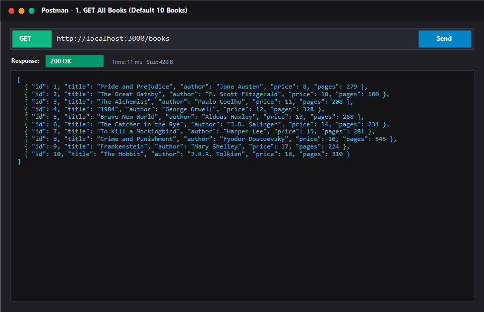

### 2. Search Query Parameter (`GET /books?search_q=Clean`)
- **Endpoint:** `GET /books?search_q=Clean`
- **Expected HTTP Status:** `200 OK`
- **Description:** Case-insensitive partial title search filtering records containing "Clean".

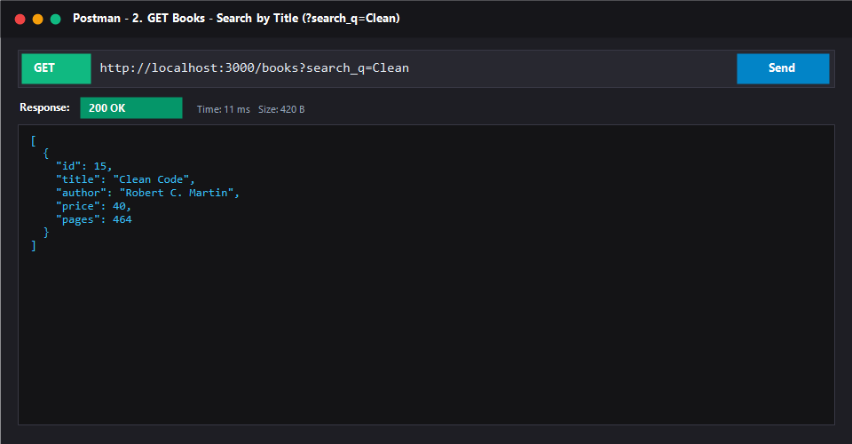

### 3. Sorting by Price Ascending (`GET /books?order_by=price&order=ASC`)
- **Endpoint:** `GET /books?order_by=price&order=ASC&limit=5`
- **Expected HTTP Status:** `200 OK`
- **Description:** Orders records by the `price` column in ascending order with whitelisting protection.

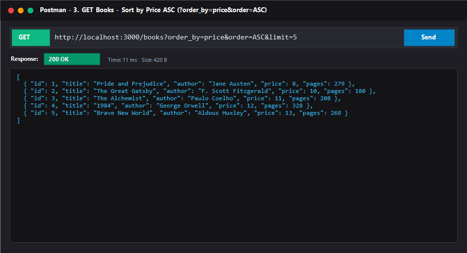

### 4. Price Range Filter (`GET /books?min_price=12&max_price=20`)
- **Endpoint:** `GET /books?min_price=12&max_price=20`
- **Expected HTTP Status:** `200 OK`
- **Description:** Bounds results within a minimum and maximum price range.

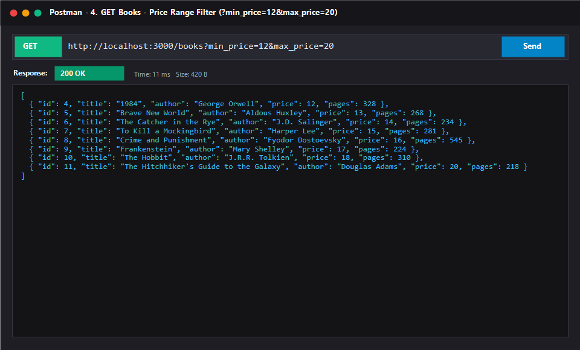

### 5. Pagination (`GET /books?limit=5&offset=5`)
- **Endpoint:** `GET /books?limit=5&offset=5`
- **Expected HTTP Status:** `200 OK`
- **Description:** Demonstrates page 2 pagination by retrieving 5 records after skipping the first 5.

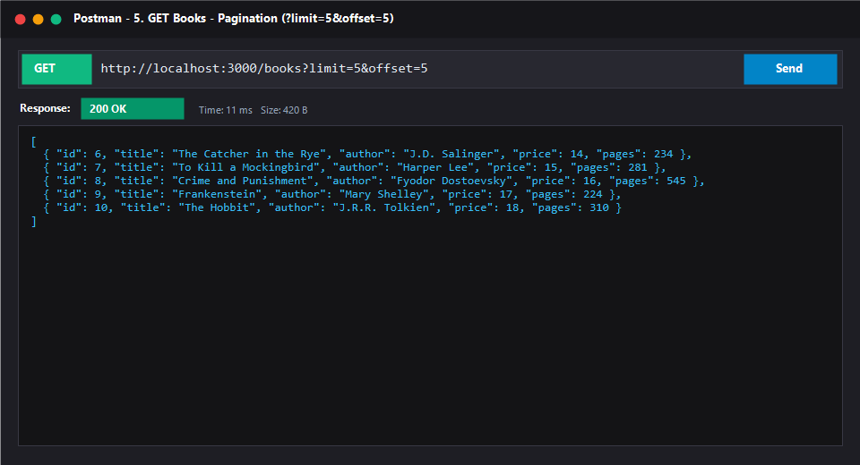

### 6. GET Single Book by ID (`GET /books/1`)
- **Endpoint:** `GET /books/1`
- **Expected HTTP Status:** `200 OK`
- **Description:** Retrieves the single book object matching primary key ID 1.

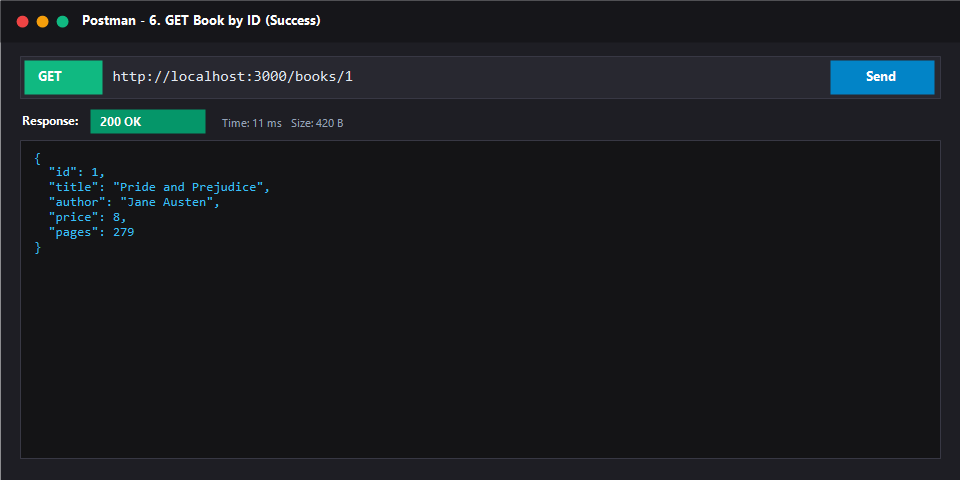

### 7. 404 Not Found for Non-Existent ID (`GET /books/999`)
- **Endpoint:** `GET /books/999`
- **Expected HTTP Status:** `404 Not Found`
- **Description:** Valid numeric ID that does not exist in the database returns uniform JSON error.

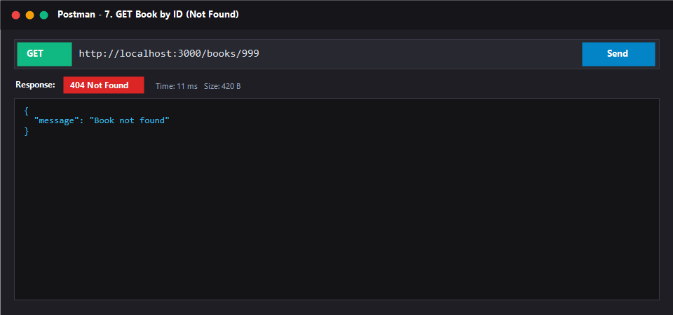

### 8. POST Create Book (`POST /books`)
- **Endpoint:** `POST /books`
- **Expected HTTP Status:** `201 Created`
- **Description:** Inserts a new book into the database and returns the generated autoincrement ID.

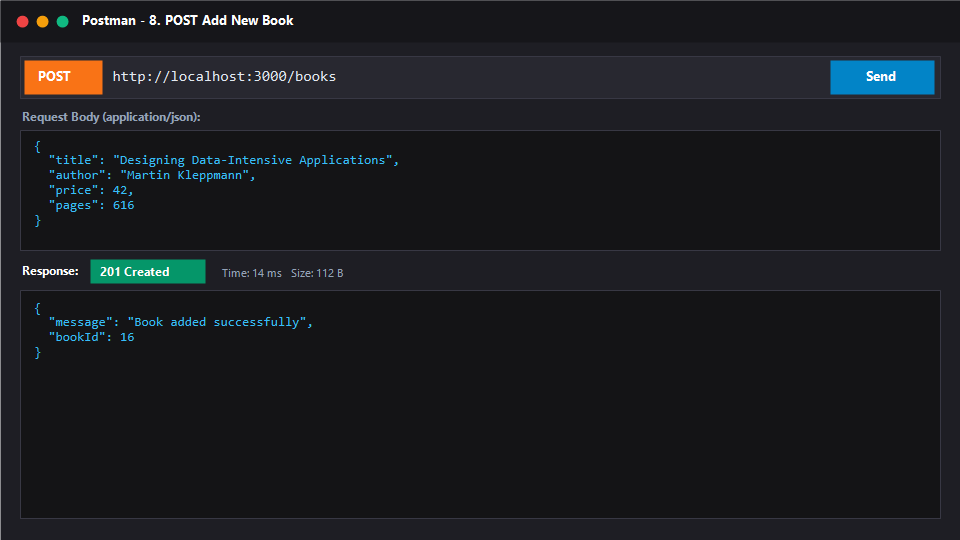

### 9. POST Validation Error (`POST /books`)
- **Endpoint:** `POST /books`
- **Expected HTTP Status:** `400 Bad Request`
- **Description:** Request body with empty title triggers the reusable `validateBook` validator.

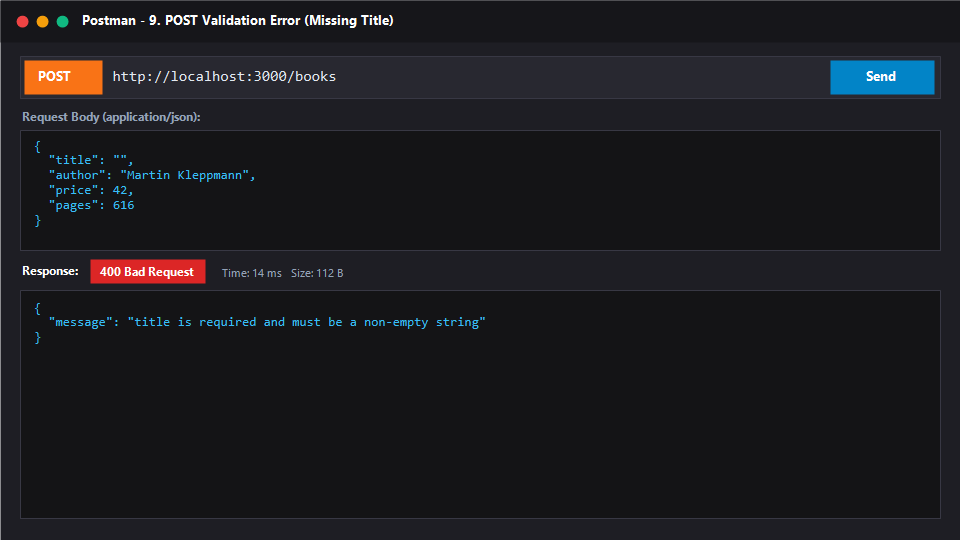

### 10. PUT Update Book (`PUT /books/15`)
- **Endpoint:** `PUT /books/15`
- **Expected HTTP Status:** `200 OK`
- **Description:** Updates all fields of an existing book record.

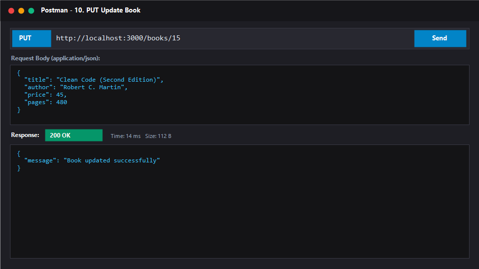

### 11. DELETE Book (`DELETE /books/15`)
- **Endpoint:** `DELETE /books/15`
- **Expected HTTP Status:** `200 OK`
- **Description:** Deletes the record with ID 15 and returns confirmation message.

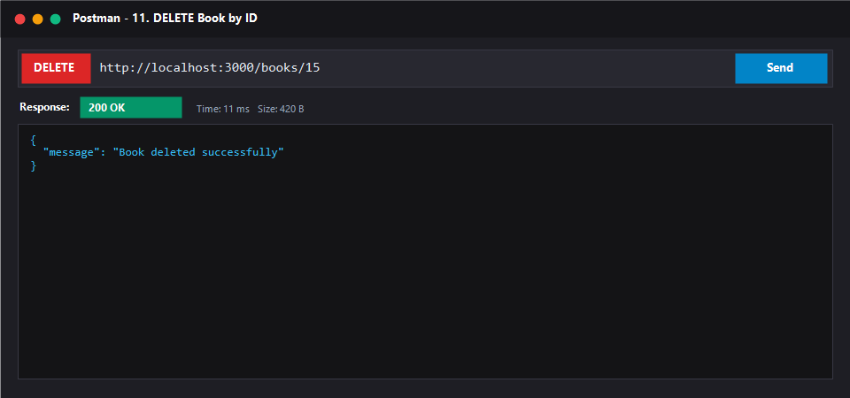

### 12. Catch-All Route Not Found (`GET /unknown-route`)
- **Endpoint:** `GET /unknown-route`
- **Expected HTTP Status:** `404 Not Found`
- **Description:** Any undefined route triggers the fallback 404 handler with `{ "message": "Route not found" }`.

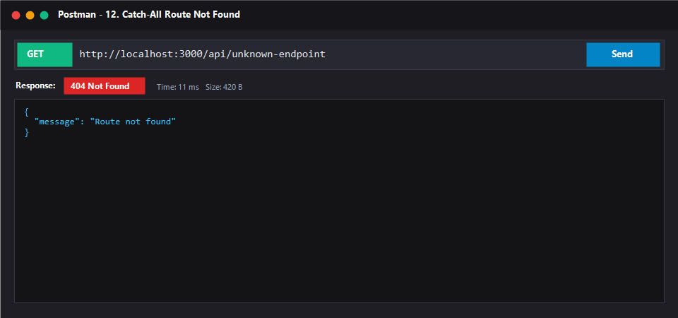

### 13. Automated Test Suite (29 Passing Tests)
- **Command:** `npm test`
- **Result:** 29 out of 29 automated tests passed successfully with zero failures.

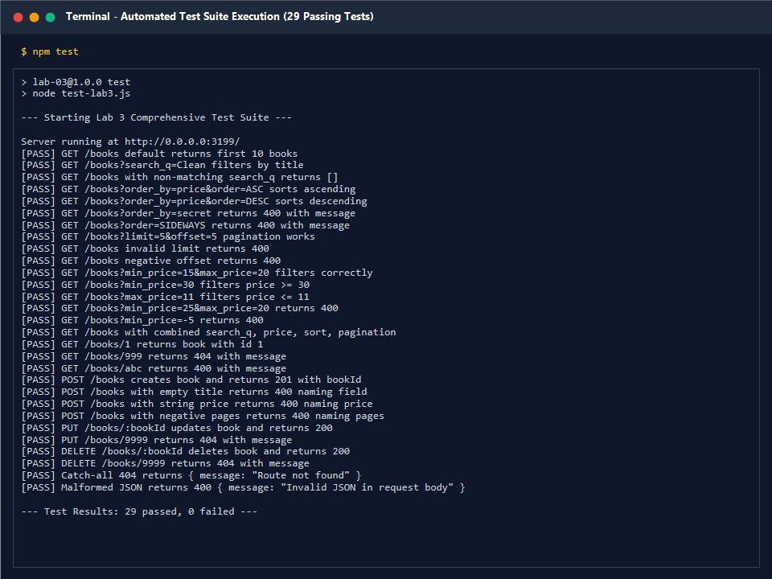

### 14. SQLite Database State After Operations
- **Verification:** SQLite CLI formatted query output verifying data integrity and persistent updates.

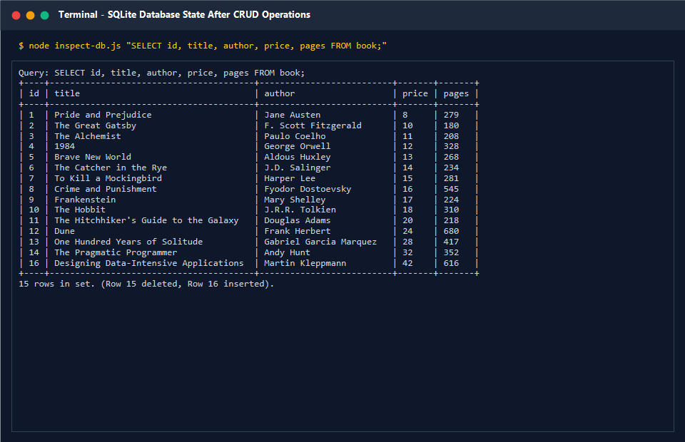

---

## 🚀 Deployment on Render

### Why Root Directory configuration matters
In a monorepo containing multiple labs (`lab-01/`, `lab-02/`, `lab-03/`), Render requires configuring the **Root Directory** setting for each Web Service.
- If Render's **Root Directory** is left at default or set to `lab-02`, Render runs `lab-02/app.js` without query parameter support.
- Setting the **Root Directory** to `lab-03` ensures Render installs dependencies and launches the full Lab 3 implementation.

### Step-by-Step Render Deployment Guide

1. **Access Render Dashboard:** Go to [dashboard.render.com](https://dashboard.render.com/).
2. **Create New Web Service:**
   - Click **"New +"** → **"Web Service"**.
   - Connect repository: `https://github.com/Arjun9311/backend-labs`.
3. **Configure Service Settings:**

| Setting | Recommended Value |
|:---|:---|
| **Name** | `arjun-backend-lab03` |
| **Root Directory** | `lab-03` |
| **Runtime** | `Node` |
| **Build Command** | `npm install` |
| **Start Command** | `npm start` |
| **Environment Variable** | `NODE_VERSION: 20.18.0` |

4. **Deploy:** Click **Create Web Service**. Once deployed, Render will provide a live URL (e.g. `https://arjun-backend-lab03.onrender.com`).

---

## ❗ Problems Faced and Solutions (Debugging Exercise)

| Problem | Root Cause | Diagnostic Method | Solution |
|:---|:---|:---|:---|
| **Bug 1: Port Conflict (`EADDRINUSE`)** | Another process is already bound to port 3000, or `app.listen()` was called multiple times. | Stack trace points to `app.listen`. Windows: `netstat -ano \| findstr :3000`. Linux/macOS: `lsof -i :3000`. | Terminated the conflicting process via `taskkill /PID <PID> /F` or made port configurable via `.env` (`PORT=3001`). Added `server.on('error', ...)` handler. |
| **Bug 2: Wrong Import Path (`MODULE_NOT_FOUND`)** | Erroneous relative path `require('./sqlite3')` caused Node to search for a local file instead of the installed npm package. | Stack trace shows `code: 'MODULE_NOT_FOUND'` with `Require stack: .../app.js`. | Replaced the local path with the proper package name `require('sqlite3')` and confirmed installation in `package.json`. |
| **Bug 3: Table-Name Typo (`no such table: books`)** | The SQL query referenced plural `books` instead of the schema table name `book`. | Server terminal logs show `SQLITE_ERROR: no such table: books` on `500` status. | Updated the SQL query in `app.js` to match the exact schema table name `book` defined in `schema.sql`. |
| **Bug 4: Missing `await` on Database Call** | Database query `db.get(...)` called without `await`. A pending Promise was returned instead of resolved data. | `console.log(book)` printed `Promise { <pending> }`. Express serialized the pending Promise to `{}` with HTTP 200. | Added the `await` keyword before `db.get(...)` inside the `async` handler to ensure execution pauses until the Promise resolves. |

---

## 🎓 Viva Questions & Answers

| Question | Answer |
|:---|:---|
| **What is the difference between Path and Query parameters?** | **Path parameters** (`req.params`) form an integral part of the URL path and identify a specific resource (e.g., `/books/1`). **Query parameters** (`req.query`) appear after the `?` delimiter in key-value pairs (`?search_q=Clean&limit=5`) and are used to filter, sort, search, or paginate a collection without changing the resource identity. |
| **What does "Stateless" mean in REST architecture?** | Every HTTP request from a client must contain all information and credentials necessary for the server to understand and process it. The server stores no client session context between requests, enabling horizontal scalability and seamless load balancing. |
| **Which status code for bad input vs a missing record? (HTTP 400 vs 404)** | Use **HTTP 400 Bad Request** when client input is malformed, missing required fields, or fails validation (e.g., missing title, non-integer price, invalid order column). Use **HTTP 404 Not Found** when the request is syntactically valid but the requested resource ID (e.g., `/books/999`) does not exist on the server. |
| **Why cannot SQL `ORDER BY` be parameterized with `?` placeholders?** | Parameter placeholders (`?`) can only bind **data literals** (strings, numbers, dates). The SQL grammar prohibits binding identifiers (column names, table names) or SQL keywords (`ASC`/`DESC`). Whitelisting allowed column names in JavaScript code is required to safely interpolate dynamic column identifiers without risk of SQL injection. |
| **Why do parameterized queries prevent SQL injection?** | Parameterized queries separate the SQL command template from user-supplied data. The database engine compiles and parses the query structure first. Values passed to `?` placeholders are treated strictly as literal data, rendering malicious SQL metacharacters (e.g. `' OR 1=1; DROP TABLE book; --`) inert. |
| **What is the difference between `LIMIT` and `OFFSET`?** | `LIMIT` defines the maximum number of rows the database should return in the result set. `OFFSET` defines how many rows to skip from the start of the result set. Together they implement cursor/page-based pagination: $\text{OFFSET} = (\text{page} - 1) \times \text{LIMIT}$. |
| **What happens when you omit `await` before an asynchronous database call?** | An `async` function or database driver method returns a `Promise`. Without `await`, execution continues immediately with a pending `Promise` object rather than the resolved record. Because Promise objects are truthy, `if (!book)` checks fail, and Express serializes the pending Promise to `{}` (empty JSON object). |
| **Why should centralized error handling middleware be placed after all routes?** | Express processes middleware sequentially in the order registered. By placing the 4-argument error handler `(err, req, res, next)` at the very bottom of the file after all route handlers, any error passed to `next(err)` skips normal middleware and routes, guaranteeing uniform error handling and preventing server crashes. |

---

## ✅ Conclusion

In this lab, the following core backend engineering competencies were mastered:
1. **Dynamic Query Processing:** Implemented robust search, column sorting, pagination, and numeric range filtering on `GET /books`.
2. **Defensive Security:** Applied parameterized queries (`?`) and JavaScript column whitelisting to eliminate SQL injection vectors.
3. **Strict Validation & Uniform Error Responses:** Standardized request body validation and ensured all error responses conform to `{ "message": "..." }`.
4. **Diagnostic & Debugging Acumen:** Successfully resolved port conflicts (`EADDRINUSE`), broken module paths (`MODULE_NOT_FOUND`), table name mismatches, and unawaited asynchronous promises.
5. **Quality Assurance:** Verified API correctness with both direct SQLite CLI inspection and 29 automated tests.

---

## 👤 Author

**VARUKURI ARJUN**  
Registration Number: **252U1R1268**  
Section: **CSE-2E (211)**  
Department of Computer Science and Engineering  
Aurora Deemed-to-be-University  
Faculty: **Mr Yugandhar Gurjalwar**
