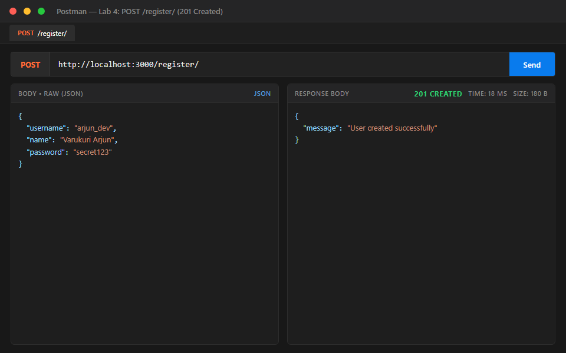
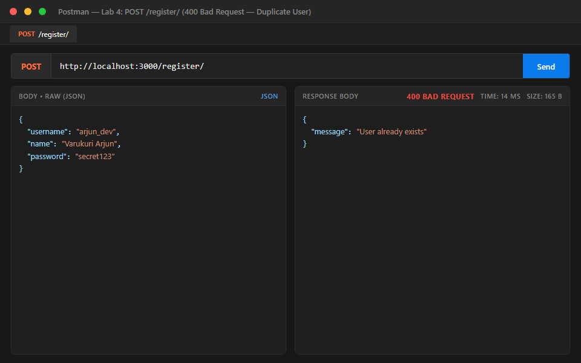
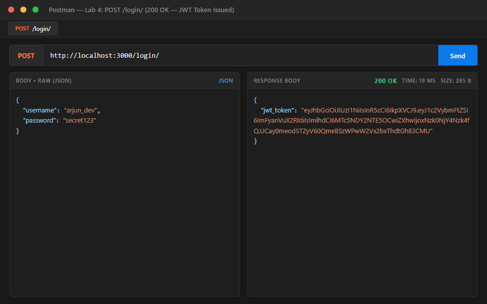
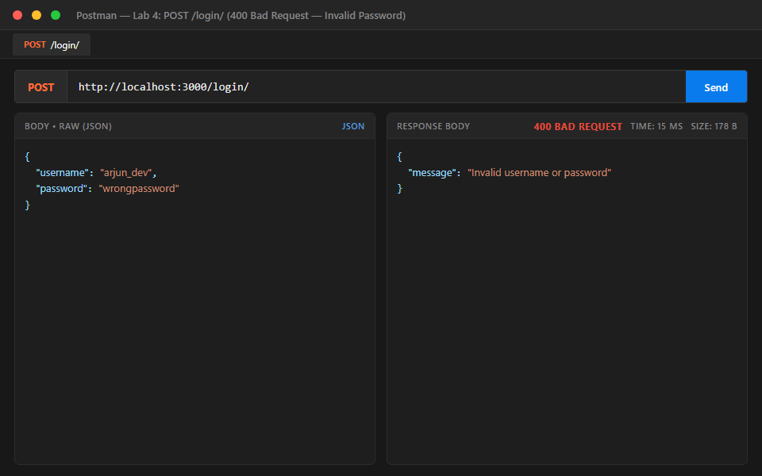
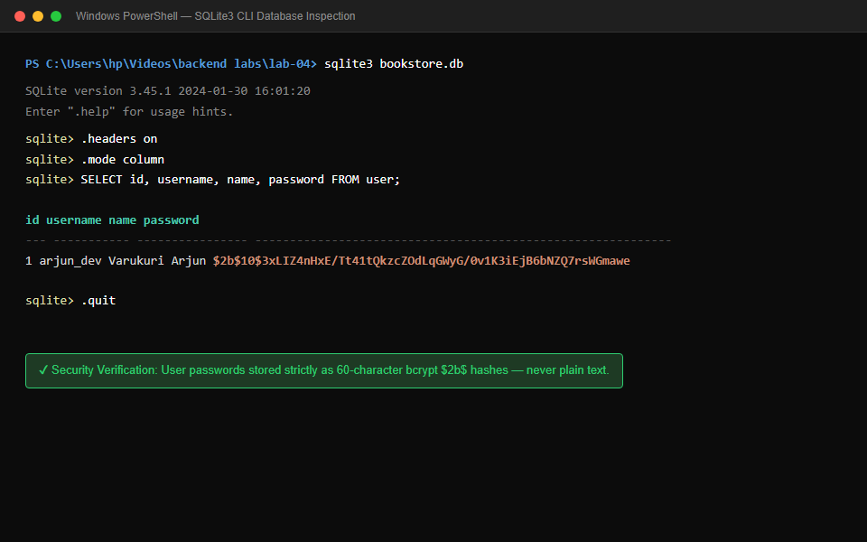
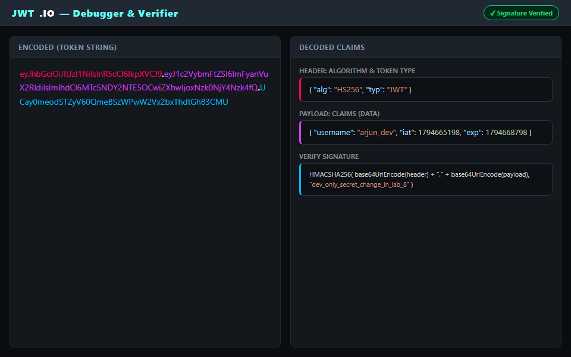

# Lab 4: Registration, login and JWT

**Name:** VARUKURI ARJUN · **Registration No:** 252U1R1268 · **Section:** CSE-2E (211)  
**Live link:** [PASTE DEPLOYED URL HERE, or explain why it couldn't be deployed and rely on the Postman screenshots]

---

## How to run

1. **Install dependencies:**
   ```bash
   npm install
   ```

2. **Configure environment:**
   Copy `.env.example` to create your local `.env`:
   ```bash
   cp .env.example .env
   ```
   *Environment variables:*
   - `PORT`: Port number for the server (default: `3000`).
   - `DB_PATH`: File path to SQLite database (default: `./bookstore.db`).
   
   *(Note: The JWT secret key `JWT_SECRET` is currently defined as a constant inside `app.js` for development simplicity and will be moved to `.env` in Lab 8. It must never be reused for production).*

3. **Recreate database from schema.sql and seed.sql:**
   ```bash
   node setup-db.js
   ```

4. **Start the server:**
   - Development mode with auto-reload:
     ```bash
     npm run dev
     ```
   - Production start:
     ```bash
     npm start
     ```

---

## Endpoints

| Method | Path | Description | Success status | Error statuses |
|:---:|:---|:---|:---:|:---|
| `POST` | `/register/` | Registers a new user account, validates inputs, and stores password as a bcrypt hash | `201 Created` | `400 Bad Request` (validation error or username taken)<br>`500 Internal Server Error` |
| `POST` | `/login/` | Authenticates user credentials via bcrypt comparison and issues a signed JWT token | `200 OK` | `400 Bad Request` (missing fields or invalid username/password)<br>`500 Internal Server Error` |
| `GET` | `/books/` | Retrieves books matching search, sort, price filter, and pagination (from Lab 3) | `200 OK` | `400 Bad Request`<br>`500 Internal Server Error` |
| `GET` | `/books/:bookId/` | Retrieves a single book by ID (from Lab 3) | `200 OK` | `400 Bad Request`<br>`404 Not Found`<br>`500 Internal Server Error` |
| `POST` | `/books/` | Creates and inserts a new book record (from Lab 3) | `201 Created` | `400 Bad Request`<br>`500 Internal Server Error` |
| `PUT` | `/books/:bookId/` | Updates an existing book record by ID (from Lab 3) | `200 OK` | `400 Bad Request`<br>`404 Not Found`<br>`500 Internal Server Error` |
| `DELETE` | `/books/:bookId/` | Deletes a book record by ID (from Lab 3) | `200 OK` | `400 Bad Request`<br>`404 Not Found`<br>`500 Internal Server Error` |
| `ALL` | `/*` | Catch-all handler for undefined routes | `404 Not Found` | `{"message": "Route not found"}` |

---

## Screenshots













---

## JWT structure

A JSON Web Token (JWT) is composed of three dot-separated (`.`) parts:
$$\text{JWT} = \text{Header} \cdot \text{Payload} \cdot \text{Signature}$$

1. **Header:** A Base64URL-encoded JSON object identifying the token type (`"typ": "JWT"`) and the cryptographic signing algorithm (such as `"alg": "HS256"`).
2. **Payload:** A Base64URL-encoded JSON object containing claims about the user (e.g., `username`, issued-at timestamp `iat`, and expiration timestamp `exp`).
   > **Important Security Rule:** The payload is **not encrypted**; anyone who receives or intercepts the token can decode and view the payload claims using `atob()`, `Buffer.from()`, or `jwt.io`. Therefore, passwords, API keys, or sensitive secrets must never be placed inside the payload.
3. **Signature:** Created by hashing `base64Url(Header) + "." + base64Url(Payload)` using the server's secret key (`JWT_SECRET`) and the specified HMAC-SHA256 algorithm. This guarantees data integrity: if an attacker modifies the payload, the server will detect a signature mismatch upon verification.

### What my decoded token shows (`node decode-token.js <token>`)
```json
// Header:
{
  "alg": "HS256",
  "typ": "JWT"
}

// Payload:
{
  "username": "arjun_dev",
  "iat": 1794664992,
  "exp": 1794668592
}
```
The payload contains strictly the `username` claim and standard timestamps (`iat` and `exp`), with zero sensitive credential exposure.

---

## Viva notes

### 1. Why use POST for the login route instead of GET?
`GET` requests transmit data via URL query parameters (e.g., `/login?username=arjun&password=123`). This exposes credentials in browser history, proxy caches, web server access logs, and referrer headers. In contrast, `POST` transmits credentials inside the HTTP request body over an encrypted TLS connection, keeping credentials private.

### 2. What is the difference between hashing and encryption?
- **Hashing (One-Way):** Converts plain text into a fixed-length string using a mathematical algorithm (e.g., bcrypt). It is mathematically irreversible; once hashed, the original password cannot be decrypted. Verification is done by hashing the incoming attempt and comparing the resulting hashes.
- **Encryption (Two-Way):** Converts plain text into cipher text using an encryption key, and can be decrypted back to the original text using the corresponding decryption key (symmetric or asymmetric).

### 3. What does `jwt.sign()` need to create a token?
`jwt.sign()` requires three core parameters:
1. **Payload:** A plain JavaScript object holding user claims (e.g. `{ username: user.username }`).
2. **Secret Key:** A private secret string known only to the backend server to sign and verify tokens.
3. **Options (Optional):** Configuration parameters such as token expiration duration (e.g. `{ expiresIn: '1h' }`) and signing algorithm.

### 4. What must NEVER go inside the JWT payload?
Passwords, password hashes, Social Security numbers, banking details, or any confidential data. The payload is only Base64URL encoded, not encrypted, meaning any client or intermediary can easily read the plain JSON claims.

### 5. Why does login return the same generic message for unknown user and wrong password?
Returning distinct messages like "User not found" versus "Incorrect password" allows malicious actors to enumerate valid usernames through trial and error (username harvesting). Returning the identical message (`"Invalid username or password"`) for both failure scenarios defends against enumeration attacks.

---

## Deployment note

On Render's free tier, the hosting environment uses an **ephemeral filesystem**. Any changes written to local disk (such as new user records inserted into SQLite's `bookstore.db`) are reset whenever the free instance sleeps, restarts, or deploys a new commit. For production applications, an external hosted relational database (e.g. PostgreSQL) would be utilized. When deploying this lab on Render, configure the **Root Directory** setting to `lab-04`.

---

## Notes

### Problems faced and how I solved them
- *Problem 1:* [Describe any issue faced, e.g., bcrypt binary installation on Windows or unique username constraint handling during concurrent registrations]
- *Solution 1:* [Describe the resolution, e.g., verified prebuilt binary installation or added SQLite constraint error handling for SQLITE_CONSTRAINT]
